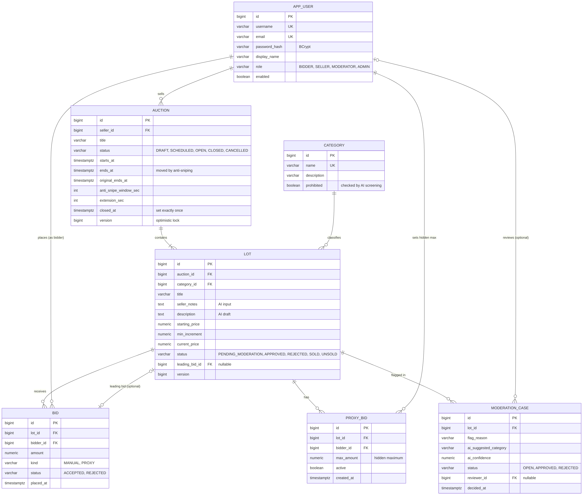
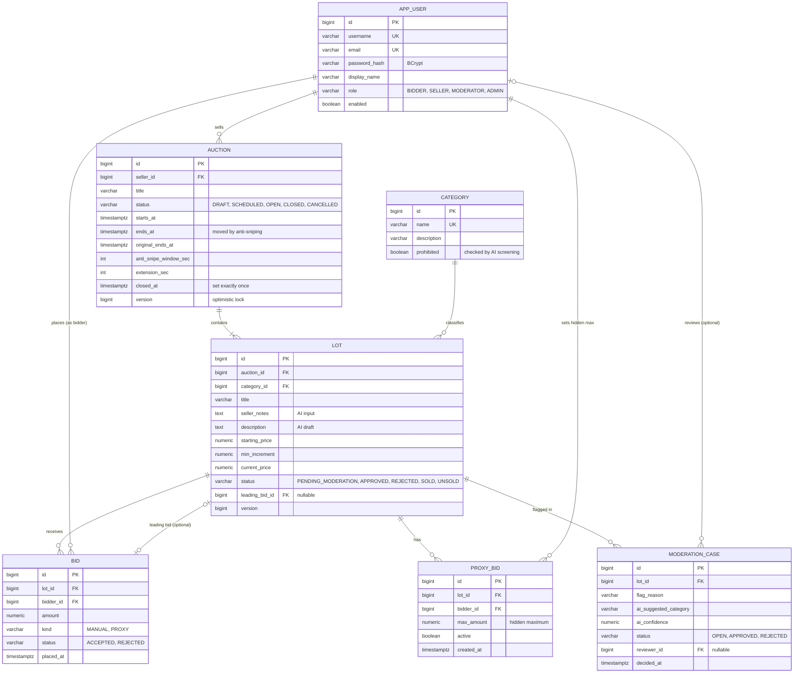

# Domain model — P34 Online auction platform

Sellers list items, buyers bid, and the highest bid at closing time wins.

**Aggregate:** `Auction → Lot → Bid → Bidder`; `Lot → Category`

## How the model supports the requirements

| Requirement | Where it lives in the model |
|---|---|
| CRUD on the aggregate | `auction` (parent) → `lot` (child) → `bid` |
| One-to-many (LO4) | `auction` → `lot`, `lot` → `bid` |
| Many-to-many with an association entity carrying attributes (LO4) | `proxy_bid` between `lot` and bidder (`app_user`), carrying `max_amount`, `active`, timestamps |
| Optional relation (LO4) | `lot.leading_bid_id`, `moderation_case.reviewer_id` |
| Advanced 1 — concurrent equal bids | Partial unique index `uq_bid_lot_amount_accepted (lot_id, amount) WHERE status = 'ACCEPTED'`; the second insert fails and that bid is rejected |
| Advanced 2 — anti-sniping | `auction.ends_at` moves forward by `extension_sec` when a bid arrives within `anti_snipe_window_sec`; `original_ends_at` keeps the seller's time |
| Advanced 3 — proxy bidding | `proxy_bid.max_amount` is never shown to other users; generated bids are stored with `kind = 'PROXY'` |
| AI feature | `lot.seller_notes` → AI → `lot.description`; flagged lots get a `moderation_case` and stay `PENDING_MODERATION` |
| Hard part — close exactly once | `auction.status` + `closed_at` + `version`; closing is a conditional update `... WHERE status = 'OPEN' AND ends_at <= now()` (see ADR-0001) |

## Roles

| Role | Can do |
|---|---|
| BIDDER | Browse open auctions, place bids, set a proxy maximum |
| SELLER | Create auctions and lots, use the AI description draft |
| MODERATOR | Review flagged lots, approve or reject them |
| ADMIN | Manage users and categories |
